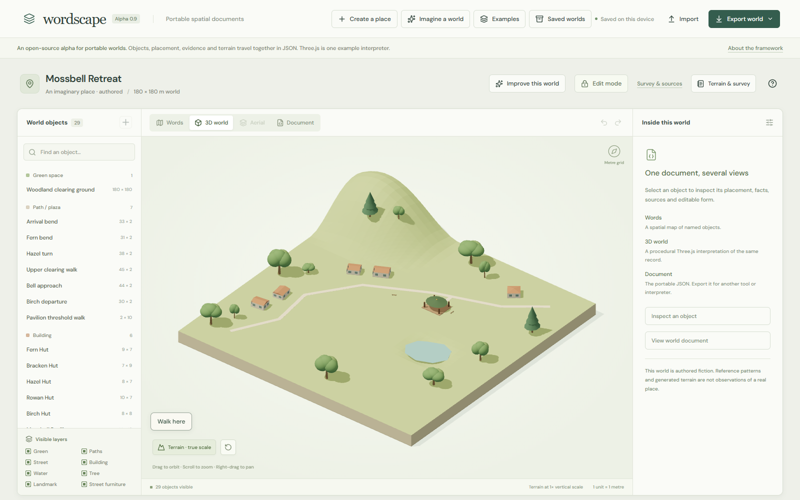
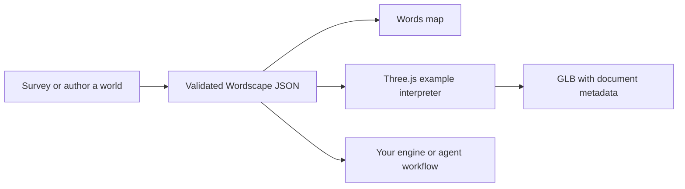

# Wordscape

**A portable world document. Many possible interpretations.**

Wordscape is an open-source **alpha framework proposal** for describing world structures as compact, editable JSON: named objects, metre-based placements, dimensions, relationships, terrain and source evidence. The same document can describe a surveyed place or an imagined one, and can travel between people, AI agents and interpreters.

The included workbench is an example implementation. Its Words map and procedural Three.js scene interpret the document; their appearance is not the framework itself. Another engine or agent can implement the contract with its own visual vocabulary. Wordscape does not promise photorealism, universal engine compatibility or identical results from arbitrary generators.

[Understand the concept](docs/FRAMEWORK.md) · [Read the format](docs/FORMAT.md) · [Use the demo](docs/DEMO_GUIDE.md) · [Build an interpreter](docs/INTERPRETERS.md)



_One interpretation of the stored document: the hill, object placements and evidence remain editable data._

## Clone and try the demo

Install Node.js 24, then run these commands in PowerShell or another terminal:

```sh
git clone https://github.com/wearywas/wordscape.git
cd wordscape
npm ci
npm run dev
```

Open **http://127.0.0.1:5173**. Choose **Examples** to explore a real survey, an imaginary village or a woodland scene. **No account or API key is needed to open examples, inspect their JSON, edit them, walk in 3D or export JSON/GLB.** The previously open world is saved before switching examples.

Live map imports require network access. Optional generation and improvement use the installed official Codex CLI with Wordscape's separate ChatGPT sign-in, or an explicitly selected server-side API key. Provider access and allowances apply; API billing is separate. The app never silently switches providers. See the [demo guide](docs/DEMO_GUIDE.md) and [local model bridge](server/ai-README.md).

For a built local app:

```sh
npm run build
npm start
```

Then open **http://127.0.0.1:8787**. The companion is a loopback development service, not a public multi-user backend.

## What travels in a world

- **Objects:** names, meanings, positions, dimensions, optional polygon footprints and parent containers.
- **Facts and evidence:** recorded values, explicit unknowns, authored interpretations and source links.
- **Relationships:** stable IDs connecting objects, without pretending every nearby object is accessible.
- **Terrain:** a sampled height grid, datum/reference information, and sourced or explicitly authored provenance.
- **Optional geometry recipes:** bounded declarative parts; no executable model code or automatic asset fetching.

Start with [a three-object example](public/examples/minimal.wordscape.json): **1,617 bytes** of compact UTF-8 JSON. Larger examples include more objects, facts, terrain and provenance. Document sizes exclude the viewer, procedural interpreter, dependencies and external images/assets; this is a compact representation, not a measured compression ratio against an equivalent finished 3D world.



## The example workbench

Use **Words**, **3D world**, **Aerial** where geographically applicable, and **Document** to inspect the same data. Placement edits require **Edit mode**. Saved worlds live in this browser's IndexedDB; export JSON for a portable copy.

**Imagine a world** accepts an optional brief, size and layout preference. Ten processed real-place Wordscapes can supply small, inspectable layout references. Authored terrain describes actual hills, ridges or basins, which become a heightfield in the saved document and exported mesh. **Improve this world** supports reviewed additions/forms; eligible imaginary worlds can explicitly replace terrain and re-ground objects. Surveyed ground remains protected. Older decorative mountain objects are not automatically deleted when adding terrain.

**Create a place** converts available OpenStreetMap vectors in a selected area, with optional sourced elevation and online aerial references. It does not identify objects from satellite pixels. Washington Square contains 165 placements, including sourced terrain and mapped peripheral buildings. Heights and colours remain clearly distinguished as mapped values, estimates or authored choices.

The renderer is deliberately simple. Generated layouts can overlap routes; foundations can be conspicuous on steep ground; walking is approximate. Authored water stays level and needs shoreline review. JSON is the editable record; GLB is one interpreter's visual result.

## Documentation and contribution

Current application: **0.9**. Current document format: **0.8**. Earlier formats remain readable; explicit migration preserves their data. This is a versioned experiment, not an established standard or packaged SDK.

- [Documentation index](docs/README.md): concept, user guide, interpreter guide and technical references.
- [Format contract](docs/FORMAT.md) and [JSON Schema](public/wordscape.schema.json): supported fields and validation rules.
- [Contributing](CONTRIBUTING.md): project structure, checks and compatibility expectations.
- [Sources and attribution](docs/SOURCES.md), [data/license notices](NOTICE.md), and [known import limits](docs/OSM_IMPORT.md).
- [Challenge prompt ledger](docs/PROMPT_LEDGER.md), [build notes](docs/BUILD_NOTES.md), and [publication notes](docs/PUBLICATION.md).

```sh
npm run check         # lint, tests, TypeScript and production build
npm run format:check
```

Browser checks use installed Chrome and a running local app; see [Contributing](CONTRIBUTING.md). Original code, schema and documentation use the [MIT license](LICENSE). Real map datasets retain **© OpenStreetMap contributors / ODbL** and their source-specific terms; see [NOTICE](NOTICE.md).
