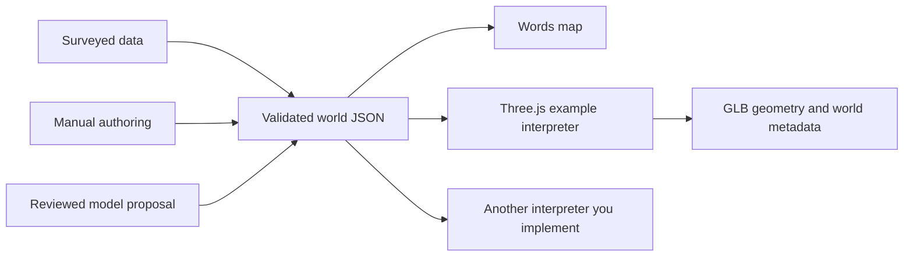

# The Wordscape framework

Wordscape proposes a portable JSON record of a bounded world: what it contains, where objects are placed, how they relate and which claims have evidence. It supports both geographic surveys and explicitly imaginary places. The current format is **0.8**; application **0.9** demonstrates it in an open-source alpha workbench.

## The document is the shared record

An object has an ID, kind, name, description, metre-based placement, dimensions and evidence. Optional fields add polygon footprints, typed facts, source references, parent containers and bounded geometry recipes. Relationships refer to object IDs. A terrain height grid can carry either sourced or explicitly authored elevations.

The [three-object garden](../public/examples/minimal.wordscape.json) is a small starting point. Its lawn, path and reading room are entirely authored. The path overlaps the lawn intentionally. A renderer can show those placements as labels, plan shapes or extruded geometry without changing the document.

Parents are semantic containers. Children store absolute world positions, so an interpreter must not apply parent transforms again. Editing helpers propagate supported container transformations into those stored positions.

## Interpreters make appearance choices

The included SVG Words map and Three.js scene read the same record. Three.js supplies one procedural interpretation of buildings, trees, fixtures, terrain and optional shape recipes. It is not the format itself.

Another interpreter must implement and document the features it supports. There is no claim that an arbitrary engine already opens Wordscape, or that free-form descriptions produce identical geometry across engines. Reproducible appearance requires the document, seed, interpreter version and its supported vocabulary. GLB is an export of the included interpreter's result, not a replacement for the editable JSON record.

## Evidence travels with the world

Object and fact evidence distinguish observations, sourced measurements, inferences, authored choices and explicit unknowns. A model-generated appearance does not verify a historical claim or a measured dimension. Real-place references guide imaginary layouts without making those fictional placements surveyed facts.

Terrain samples retain their datum and reference elevation. Missing values remain gaps. Authored terrain is explicitly marked; absent legacy provenance is not treated as permission to replace real ground. Aerial metadata describes an external imagery reference, not a portable copy of image pixels.

## Scope and limits

The format stores bounded static scenes, not a complete game engine, GIS database or digital twin. It does not define physics, interior navigation, animation, arbitrary executable scripts or general texture/asset packaging. The current geometry recipe vocabulary is deliberately small. New-area import converts mapped vector data; it does not identify buildings from satellite images.

The displayed document size measures compact UTF-8 JSON, including recorded terrain when present. It excludes the app, renderer, dependencies and external imagery or assets. A small file still needs an interpreter; this is not a compression claim.

Current ordinary documents are bounded to 1,000 objects and 4 MiB input. Compatible composed surveys have separate limits of 4,000 objects and 16 MiB. These are validation limits, not performance guarantees. See [FORMAT.md](FORMAT.md) for the complete contract and [INTERPRETERS.md](INTERPRETERS.md) before building a consumer.
